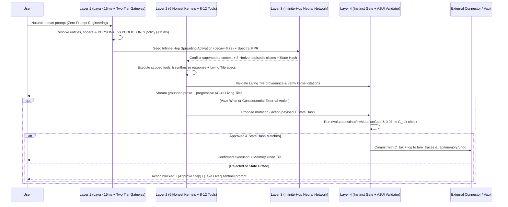

# RFC 0001: Infinite-Hop Personal Neural Networks, Epistemic Grounding & Instinct Action Governance

**Network Working Group**  
**Request for Comments:** 0001 (Master Plan v5)  
**Category:** Protocol Standards  
**Author:** Richard Ewing, Exogram Protocol Team ([exogram.ai](https://exogram.ai))  
**Updated:** October 2026

---

> ### ⚡ The 2-Second Summary
> **RFC 0001** defines the open standard for giving AI models an **Infinite-Hop Personal Neural Network** (`Work · People · Life`), a **Two-Tier Privacy Gateway** (`PERSONAL` vs. `PUBLIC_ONLY`), **A2UI Composable Living Tiles**, and **0.07ms Instinct Action Governance**—so your AI remembers your life across sessions, proves every claim with predicate-level citations, and executes real work safely.

---

## 1. Abstract

This specification defines the **Exogram Protocol (Master Plan v5)**: an open architecture for persistent personal memory, multi-hop associative reasoning, verifiable UI synthesis, and deterministic action authorization.

Standard conversational AI deployments fail in four ways:
1. **Session Amnesia & Shallow Recall:** Models reset every conversation, and naive vector RAG or rigid shallow graph lookups miss multi-hop connections across a user's work, family, and personal life.
2. **Privacy Leakage Across Model Pools:** Routing raw personal prompts to external search tools or multi-provider model pools leaks private identifiers, family details, and vault notes.
3. **Unverified Prose & Hallucinated UI:** Models emit walls of unverified text or fabricate prices, scores, and placeholder checklists without provenance validation.
4. **Ungoverned Tool Execution:** Granting probabilistic models direct write access to email, calendars, browser operators, or memory vaults leads to silent memory corruption and unintended external side effects.

The Exogram Protocol resolves these failure modes through four tightly coupled layers operating in a closed loop.

---

## 2. Conventions and Terminology

The key words "MUST", "MUST NOT", "REQUIRED", "SHALL", "SHALL NOT", "SHOULD", "SHOULD NOT", "RECOMMENDED", "MAY", and "OPTIONAL" in this document are to be interpreted as described in [RFC 2119](https://tools.ietf.org/html/rfc2119).

- **Personal Neural Network:** A living topological hypergraph partitioning user entities and claims across three interconnected spheres: `Work`, `People`, and `Life`.
- **Infinite-Hop Associative Spreading Activation:** Iterative energy propagation across the entity graph with decay factor $\gamma = 0.72$ and inverse square-root hub degree damping $1/\sqrt{\text{deg}(v)}$.
- **3-Horizon Episodic Memory:** Temporal classification of extracted claims into `ephemeral_episode` (36-hour `valid_until` TTL), `recurring_event` (`RRULE:FREQ=YEARLY`), or `durable_trait`.
- **Subtask Data Policy (`PERSONAL` vs. `PUBLIC_ONLY`):** Strict routing boundary ensuring private vault context stays on zero-retention Paid Gemini 3.8 Flash / 2.5 Pro while public web/extraction subtasks are scrubbed via `stripVaultAndPiiFromPublicSubtask`.
- **6 Honest Kernels:** First-party specialist execution kernels (`Neural Graph Kernel`, `Generative UI Kernel`, `Live Web & Places Scout`, `Action & Draft Kernel`, `Analytical Synthesis Kernel`, `Grounded Citation Kernel`) governed by the 6-Point Agent Contract.
- **Instinct Pre-Mutation Gate:** Deterministic pre-write judgment gate (`evaluateInstinctPreMutationGate`) that inspects candidate vault writes for contradictions, low-signal noise, or untrusted prompt injection before persistence.
- **Execution Token ($C_{tok}$):** Cryptographic HS256 JWT binding an authorized tool or operator action to the exact SHA-256 context state hash ($\mathcal{H}_{state}$) and payload hash ($\mathcal{H}_{payload}$).

---

## 3. Core Architecture (Master Plan v5)

### 3.1 Layer 1: Laya `<15ms` Deterministic Fast-Path & Two-Tier Inference Gateway

Before invoking any foundation model, the **Laya System 1 Preflight** (`resolveDeterministicLayaUnderstanding`) resolves vault subjects, intent classification, sphere affinity (`Work`, `People`, `Life`), and retrieval queries in **under 15ms** directly in-memory over `profileDigest` and `priorTurns`, achieving a `<= 1.6s` P50 Time-To-First-Token (TTFT).

Every inference subtask is classified under a mandatory **Subtask Data Policy**:
- **`PERSONAL` Subtasks:** Vault-grounded synthesis, episodic memory consolidation, and scalar conflict resolution route exclusively to Paid Gemini 3.8 Flash (with extended thinking) and Gemini 2.5 Pro fallback under Zero Data Retention (ZDR).
- **`PUBLIC_ONLY` Subtasks:** Public web lookups, place verification, and structured page extractions pass through `stripVaultAndPiiFromPublicSubtask` and `compressPublicContextTokens` before routing to the multi-provider pool.

### 3.2 Layer 2: 6-Point Agent Contract, 6 Honest Kernels & 8–12 Semantic Tool Selector

Exogram never exposes bloated 50-tool arrays or black-box third-party bots. Instead:
1. **Semantic 8–12 Tool Selector (`tool_discovery.ts`):** Every turn scopes outbound declarations to **5 core meta-tools** (`render_live_widget`, `search_memory_vault`, `update_memory_vault`, `find_tool`, `extract_public_page_records`) plus **5–7 semantically matched domain tools** ($\le 12$ total tools per turn). Every tool output is wrapped in a normalized provenance envelope flagging `provenance.untrusted_content` and `residual_unknowns`.
2. **The 6 Honest First-Party Kernels (`agent_swarm_router.ts`):**
   - `Neural Graph Kernel` — Traverses the Infinite-Hop Personal Neural Network and resolves scalar conflicts.
   - `Generative UI Kernel` — Compiles and validates A2UI Composable Living Tiles.
   - `Live Web & Places Scout` — Executes PII-scrubbed public web and venue verification.
   - `Action & Draft Kernel` — Prepares governed email drafts, calendar events, and Instinct browser errands.
   - `Analytical Synthesis Kernel` — Performs deep multi-constraint tradeoff and decision-matrix synthesis.
   - `Grounded Citation Kernel` — Enforces claim-predicate entailment (`scoreClaimPredicateEntailment`) and post-synthesis citation verification (`verifyAgentContributionsAgainstTurnOutput`). Only kernels whose retrieved facts are genuinely cited in the final turn output earn the `Complete · Cited` status badge.

### 3.3 Layer 3: Infinite-Hop Personal Neural Network & 3-Horizon Episodic Memory

Traditional vector similarity ($\cos(\theta)$) measures lexical proximity without understanding relational topology, temporal validity, or factual supersession. Similarly, rigid fixed-hop breadth-first searches fail when a decision depends on a chain of four or five associative links (e.g., *Daughter's soccer tournament $\to$ Saturday schedule conflict $\to$ Partner's flight arrival $\to$ Preferred neighborhood dinner spot $\to$ Dietary constraint*).

Exogram combines **Infinite-Hop Associative Spreading Activation** with **HippoRAG 2 Spectral Personalized PageRank (PPR)**:

$$
\mathbf{a}^{(t+1)} = (1 - \alpha)\,\mathbf{s}_0 + \gamma \, D^{-1/2} A D^{-1/2} \mathbf{a}^{(t)}, \quad \text{with hub damping } w(v) = \frac{1}{\sqrt{1 + \text{deg}(v)}}
$$

Where:
- $\mathbf{s}_0$ is the initial seed activation vector anchored on the user's self-node and Laya-resolved entities.
- $\gamma = 0.72$ is the associative spreading decay factor across multi-hop edges until convergence.
- $D^{-1/2} A D^{-1/2}$ applies symmetric spectral degree normalization so high-degree hub nodes (such as the user's primary company or city) cannot flood unrelated personal turns.

Retrieved candidates are fused via **4-Way Reciprocal Rank Fusion ($k=60$)** combining Pinecone dense vectors, lexical BM25 match, Infinite-Hop graph activation, and profile digest salience.

#### 3-Horizon Episodic Memory & Scalar Conflict Supersession
Every memory claim is governed by `episodic_memory_lifecycle.ts`:
1. **`ephemeral_episode`:** Short-lived context (e.g., *"picking up dry cleaning at 4 PM today"*) assigned an automatic 36-hour `valid_until` TTL so transient tasks never pollute future turns.
2. **`recurring_event`:** Cyclical milestones (birthdays, anniversaries, annual reviews) encoded with RFC 5545 `RRULE:FREQ=YEARLY` recurrence schedules.
3. **`durable_trait`:** Long-term facts, relationships, dietary rules, and architectural preferences.
4. **Read-Time Scalar Conflict Supersession:** Single-valued scalar attributes (home location, property acreage, child's current grade level, role title) automatically supersede older conflicting records in favor of the latest verified claim, while work/venture mega-topics are capped during personal/family turns.

### 3.4 Layer 4: A2UI Living Tiles, Instinct Operator & `0.07ms` Action Governance

When a turn requires structured visual output or real-world execution, Exogram enforces three deterministic boundaries:

1. **A2UI Composable Living Tile Provenance Validator (`tile_spec_validator.ts`):** Validates all 13 Living Tile types (`action_draft`, `checklist`, `decision_matrix`, `curated_places`, `comparison_table`, `retail_deals_tile`, `media_watch_tile`, `occasion_countdown_tile`, `memory_undo_tile`, `agent_hud_tile`, `branded_diagram_tile`, `hyperframes_video_tile`, `instinct_computer_tile`). It blocks placeholder checklists on factual media queries and rejects ungrounded prices or ratings.
2. **Instinct Pre-Mutation Gate (`evaluateInstinctPreMutationGate`):** Evaluates proposed vault mutations in `<0.07ms` before any fact writes to SQLite WAL or Supabase Postgres.
3. **Cryptographic Execution Tokens ($C_{tok}$) & Sentinel Controls:** Consequential external actions (sending an email via Gmail, booking a household errand via `instinct_computer_tile`, or modifying calendar events) require human-on-the-loop `[Approve Step]` or `[Take Over]` confirmation and a state-hash-bound $C_{tok}$:

$$
\forall P \in \mathcal{T}, \quad \mathbf{Execute}(P) \iff \left( \mathcal{H}(S_{\text{live}}) = \mathcal{H}(S_{\text{context}}) \right) \land \left( \Gamma(P) \subseteq C_{\text{scope}} \right)
$$

---

## 4. Protocol Execution Sequence

---

## 5. What This Looks Like in Practice

- **Multi-Hop Personal & Household Synthesis:** A user asks, *"Plan Saturday afternoon around Maya's game and find a quiet spot nearby where we can review the Q4 board deck afterward."* Exogram traverses infinite hops across `People` (Maya's soccer schedule & field location), `Life` (dietary preferences, quiet seating preference), and `Work` (active Q4 board deck milestone), stripping personal identifiers before `Live Web & Places Scout` verifies open venues, and renders a `curated_places` tile alongside a `checklist` tile.
- **Instant User Correction (`/api/memory/undo`):** If the user says, *"We moved from the 2-acre lot to the 5-acre property in October,"* Read-Time Scalar Conflict Supersession immediately updates the active acreage scalar, excludes the outdated assumption from retrieval, and emits a `memory_undo_tile` linked to `/api/memory/undo`.
- **Governed Household vs. Work Execution:** When the `Action & Draft Kernel` prepares an email to a client or the `instinct_computer_tile` stages a multi-step web checkout, `Household` memory claims are isolated from `Work` A2A payloads, and the final submission is gated by `[Approve Step]` and a 2-second $C_{tok}$ token.

---

## 6. Reference Benchmarks

- **`< 15ms`** Laya System 1 deterministic in-memory preflight latency
- **`<= 1.6s`** P50 Time-To-First-Token (TTFT) on vault-grounded turns
- **`0.07ms`** deterministic Instinct & $C_{tok}$ policy evaluation latency
- **`<= 12`** outbound tool declarations per turn (5 core meta-tools + 5–7 semantic tools)
- **`100%`** post-synthesis citation verification (`verifyAgentContributionsAgainstTurnOutput`)

**End of RFC 0001**
