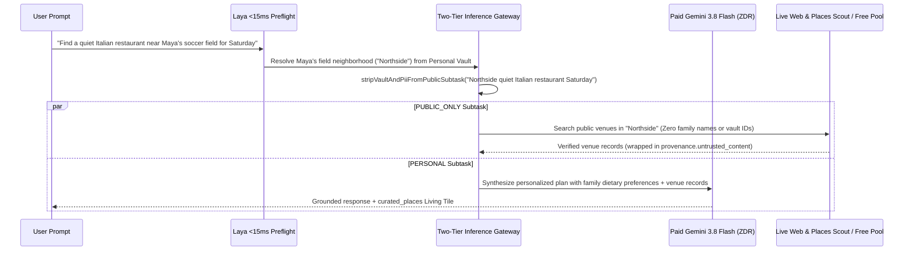
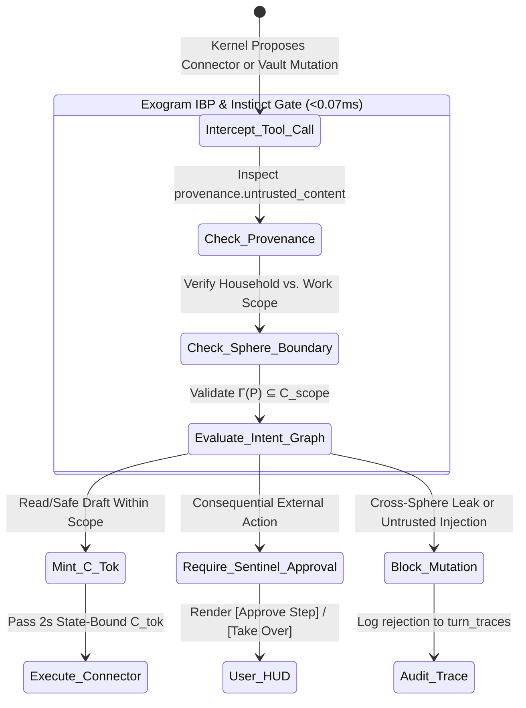

# RFC 0002: Intent-Based Permissioning & Scope Isolation (`PERSONAL` vs. `PUBLIC_ONLY` & `Household` vs. `Work` A2A)

**Network Working Group**  
**Request for Comments:** 0002 (Master Plan v5)  
**Category:** Security & Privacy Architecture Standards  
**Author:** Richard Ewing, Exogram Protocol Team ([exogram.ai](https://exogram.ai))  
**Updated:** October 2026

---

> ### ⚡ The 2-Second Summary
> Giving an AI assistant standing credentials across your personal life and work tools leaks private family context into external APIs and risks unintended actions. **Intent-Based Permissioning (IBP)** enforces strict **`PERSONAL` vs. `PUBLIC_ONLY`** inference routing, isolates **`Household` vs. `Work`** A2A trust boundaries, and evaluates exact payload intent in **0.07ms** before any connector executes.

---

## 1. Abstract

Traditional access control grants static, standing permissions to a service identity. When applied to a personal AI agent connected to Gmail, Google Calendar, Google Drive, and a stateful browser operator, static permissions create two severe vulnerabilities:
1. **Cross-Sphere Context Leakage:** Private family, medical, or household notes stored in the user's vault are inadvertently transmitted to public web search APIs, third-party model pools, or workplace A2A collaborators.
2. **Unbounded Connector Mutation:** A model holding standing OAuth scopes for email or browser automation can misinterpret an ambiguous prompt or an untrusted web page (`provenance.untrusted_content`) and send an unapproved message or modify the wrong calendar event.

This document defines **Intent-Based Permissioning (IBP)** under Master Plan v5: a dual boundary that governs **where data is allowed to route** (`SubtaskDataPolicy`) and **what physical mutations an agent is allowed to execute** (`Household` vs. `Work` scope isolation + `0.07ms` intent gates).

---

## 2. Subtask Data Policy: `PERSONAL` vs. `PUBLIC_ONLY`

Every turn entering the Exogram Two-Tier Inference Gateway (`inference_gateway.ts`) is decomposed into subtasks classified as either `PERSONAL` or `PUBLIC_ONLY`:

| Subtask Policy | Permitted Context | Allowed Model Routing | Mandatory Sanitization |
| :--- | :--- | :--- | :--- |
| **`PERSONAL`** | Full encrypted Memory Vault, Infinite-Hop Personal Neural Network (`Work · People · Life`), 3-Horizon episodic claims, and personal documents. | Paid Gemini 3.8 Flash (primary with thinking) & Paid Gemini 2.5 Pro (fallback) under strict Zero Data Retention (ZDR). | Never routed to free-token pools or public web scrapers. |
| **`PUBLIC_ONLY`** | Sanitized search queries, public URLs, and generic domain constraints. | Multi-Provider Free-Token Pool (Groq LPU, NVIDIA NIM, OpenRouter Free, OmniRoute) & `Live Web & Places Scout`. | Must pass through `stripVaultAndPiiFromPublicSubtask` + `compressPublicContextTokens` prior to dispatch. |

---

## 3. `Household` vs. `Work` A2A Trust Boundaries

Inspired by `mariagorskikh/open-instinct`, Exogram partitions agent-to-agent (A2A) and connector permissions across two strict trust zones:

1. **`Household` Scope (`People` & `Life` Spheres):**
   - Covers family calendars, school schedules, personal health notes, home property records, and shared partner checklists.
   - Trusted-person coordination (e.g., syncing a weekend checklist or anniversary countdown) is strictly prohibited from reading or attaching `Work` sphere artifacts (board decks, client contracts, proprietary repositories).
2. **`Work` Scope (`Work` Sphere):**
   - Covers professional email drafts (`Action & Draft Kernel`), Google Drive workspace docs, engineering repositories, and executive briefings.
   - Outbound professional actions (`action_draft_tile`, calendar invites to external domains) are mathematically blocked from referencing `Household` private entities unless explicitly overridden by the user.

---

## 4. Connector Intent Verification (`0.07ms`)

Instead of granting blanket write authority to connectors (Gmail, Google Calendar, Google Drive, or the Instinct Browser Operator), Exogram evaluates the **Intent Graph** $\Gamma_{\text{intent}}(P)$ of every proposed tool call against the active turn's bounded scope $C_{\text{scope}}$:

$$
\text{Auth}(P) \iff \left( \Gamma_{\text{intent}}(P) \subseteq C_{\text{scope}} \right) \land \left( \text{UntrustedOrigin}(P) = \mathbf{False} \right) \land \left( \mathcal{H}(S_{\text{live}}) = \mathcal{H}(S_{\text{context}}) \right)
$$

### 4.1 Defense Against Indirect Prompt Injection (`provenance.untrusted_content`)
When `extract_public_page_records` or `Live Web & Places Scout` ingests external web content, the output is wrapped in a normalized provenance envelope with `provenance.untrusted_content = true`.

If an untrusted web page contains hidden instructions attempting to trigger `update_memory_vault` or dispatch an email via `Action & Draft Kernel`, the **Instinct Pre-Mutation Gate** (`evaluateInstinctPreMutationGate`) and the IBP Gate detect that the mutation intent originated from an untrusted provenance envelope rather than the user's verified prompt, blocking the action in `<0.07ms`.

---

## 5. Implementation Requirements

To comply with RFC 0002, any Exogram-compatible runtime MUST:
1. Enforce the 8–12 Semantic Tool Selector (`tool_discovery.ts`) so agents only receive tools matching the user's verified turn intent.
2. Scrub all `PUBLIC_ONLY` subtasks via `stripVaultAndPiiFromPublicSubtask` before invoking external search or free-tier inference endpoints.
3. Enforce `Household` vs. `Work` sphere isolation across all FastMCP connectors and Instinct operator sessions.
4. Require a cryptographic $C_{tok}$ token (RFC 0003) for every state-mutating connector call.

**End of RFC 0002**
