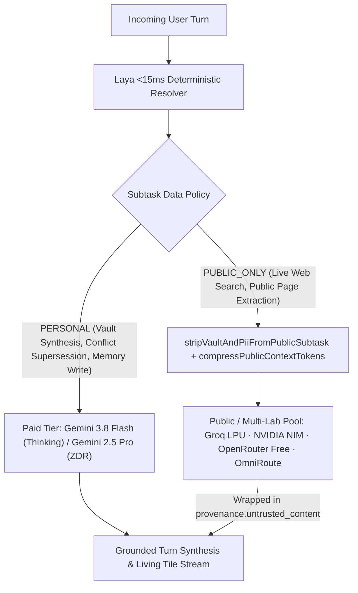

# Layer 1: Two-Tier Inference Gateway & Laya `<15ms` Deterministic Fast-Path

> ### ⚡ The 2-Second Summary
> **Layer 1** eliminates blocking network preflights and cross-provider privacy leaks. **Laya** resolves vault subjects, intent, and sphere affinity in **`<15ms`** in-memory (achieving `<= 1.6s` P50 TTFT), while the **Two-Tier Inference Gateway** routes `PERSONAL` subtasks exclusively to zero-retention Paid Gemini 3.8 Flash / 2.5 Pro and scrubs `PUBLIC_ONLY` subtasks before calling the multi-provider pool.

---

## 1. Abstract

In standard AI wrappers, every prompt either hits a slow preliminary LLM classifier—adding 800ms to 2,000ms of dead latency before retrieval even starts—or dumps raw personal context directly into external model APIs and web search tools.

Layer 1 of the Exogram Protocol (Master Plan v5) solves both problems through two mechanisms:
1. **Laya System 1 Deterministic Fast-Path (`query_understanding.ts` / `laya_preflight.ts`):** Resolves mentioned people, projects, temporal horizons, and sphere routing (`Work`, `People`, `Life`) in **`<15ms`** in-memory over `profileDigest` and `priorTurns`.
2. **Two-Tier Inference Gateway (`inference_gateway.ts`):** Enforces a strict cryptographic and programmatic split between `PERSONAL` subtasks and `PUBLIC_ONLY` subtasks.

---

## 2. Laya System 1 Deterministic Preflight (`<15ms`)

Rather than making a blocking network call to an LLM just to understand what the user is asking about, `resolveDeterministicLayaUnderstanding` executes in-memory against the user's loaded `profileDigest` and recent turn buffer:

```text
User Prompt + Prior Turns + Profile Digest
   │
   ▼  (< 15ms In-Memory Execution)
┌─────────────────────────────────────────────────────────────────────────┐
│ Laya System 1 Deterministic Resolver                                    │
│  1. Entity & Relationship Matching: Maps first names & projects to IDs  │
│  2. Sphere Affinity Scoring: Weights Work vs. People vs. Life spheres   │
│  3. Subtask Data Policy Classification: PERSONAL vs. PUBLIC_ONLY        │
│  4. Seed Vector Assembly: Prepares origin nodes for Infinite-Hop Graph  │
└─────────────────────────────────────────────────────────────────────────┘
   │
   ▼
<= 1.6s P50 Time-To-First-Token (TTFT)
```

---

## 3. Two-Tier Subtask Data Policy (`PERSONAL` vs. `PUBLIC_ONLY`)

Exogram never mixes private vault records with public free-token pools. Every subtask is governed by `SubtaskDataPolicy`:



### 3.1 `PERSONAL` Tier (Paid Zero-Retention Frontier)
- **Workloads:** Personal Neural Network synthesis, 3-Horizon episodic memory extraction, Read-Time Scalar Conflict Supersession, and `Action & Draft Kernel` reasoning.
- **Models:** Paid **Gemini 3.8 Flash** (primary with thinking enabled) and **Gemini 2.5 Pro** (deep analytical fallback).
- **Guarantee:** Zero model training on personal data; full vault context remains inside the private boundary.

### 3.2 `PUBLIC_ONLY` Tier (Sanitized Multi-Lab Pool)
- **Workloads:** Public place lookups, retail price checks, streaming availability queries, and public documentation extraction.
- **Mandatory Sanitization:** Before any `PUBLIC_ONLY` subtask executes, `stripVaultAndPiiFromPublicSubtask` removes personal names, family relationships, addresses, and vault identifiers, while `compressPublicContextTokens` trims the payload to pure public query constraints.
- **Provenance Isolation:** Responses returning from the public pool are tagged with `provenance.untrusted_content = true` and `residual_unknowns` so they can never directly trigger vault mutations or connector side-effects.

---

## 4. Turn Completeness & Stream Integrity

Layer 1 enforces **Turn Completeness (`ensureCompleteConversationalProse`)**:
- An SSE stream is never allowed to close if the model prose ends with a dangling colon (`:`) or promises a breakdown without rendering the body content or the corresponding A2UI Living Tile (`rescueMalformedWidgetEnvelope`).

---

## Related Specifications

- [RFC 0001: Infinite-Hop Personal Neural Network & Instinct Governance](../0001-exogram-protocol-specification.md)
- [RFC 0002: Intent-Based Permissioning & Scope Isolation](../0002-intent-based-permissioning.md)
- [Layer 2: 6-Point Agent Contract & 8–12 Semantic Tool Selector](layer-2-orchestration-connectors.md)
- [Layer 3: Infinite-Hop Personal Neural Network & 3-Horizon Memory](layer-3-memory-vault-graph.md)
